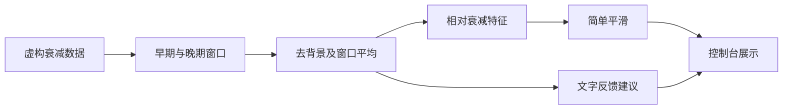

# Fluorescent Fiber Thermometer · C 演示项目

用简化的 C 代码介绍荧光测温软件的数据处理思路：组织采样、选择窗口、去除背景、提取衰减特征、平滑结果，再形成反馈建议。

本项目定位为**设计说明与代码阅读演示**。数据由数学公式虚构，横轴和输出均为无量纲示意值。代码不包含设备驱动、实际采样时序、控制参数、标定数据或温度输出，不构成可烧录的测温固件。

全部项目源码使用标准 C11，没有汇编源文件、内联汇编或芯片 SDK。可选地在电脑上运行，观察各模块如何传递数据。

## 处理流程



温度映射仅在文档中说明其作用，项目不提供映射表或实际测温实现。

## 代码入口

| 文件 | 说明 |
|---|---|
| [src/main.c](src/main.c) | 串联流程，打印八组虚构输入的处理结果 |
| [src/simulation.c](src/simulation.c) | 生成带背景的示意衰减序列 |
| [src/analysis.c](src/analysis.c) | 选择两个窗口、去背景、计算对数比值特征 |
| [src/smoothing.c](src/smoothing.c) | 用简单加权平均展示平滑的含义 |
| [src/feedback.c](src/feedback.c) | 返回 increase / hold / decrease 文字建议 |
| [include/demo.h](include/demo.h) | 数据结构和模块接口 |
| [tests/test_demo.c](tests/test_demo.c) | 演示计算和输入边界检查 |

详细文字说明集中在 [设计说明](docs/design.md)，阅读顺序见 [代码导读](docs/code-guide.md)。

## 可选运行

使用带标准 C 库和数学库的 GCC 或 Clang，以及 Make：

```sh
make run
make test
```

生成文件位于忽略的 `build/` 目录。程序只进行内存计算和控制台输出，不查找或连接外部设备。

输出中的 `feature` 和 `smoothed` 是相对特征，不能读作微秒或摄氏度；`suggestion` 只展示判断分支，不会输出控制指令。示例中的采样数量、窗口位置、平滑权重和比较值均为演示设定。

## 许可证

本仓库的演示代码和文档采用 [MIT 许可证](LICENSE)，版权归 valiidea 所有。允许复制、修改、分发和商业使用，需保留版权与许可声明；具体条件以 LICENSE 为准。

许可范围为本仓库发布的文件。源码中未捆绑第三方实现；编译器及其标准库按各自的许可证使用。
