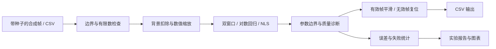
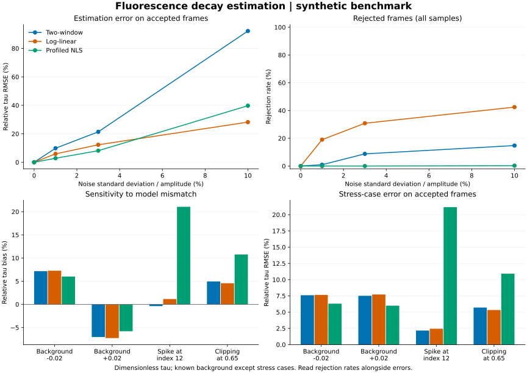

# Fluorescent Fiber Thermometer

**荧光衰减信号处理与可复现实验工具 · C11 / Python**

[](https://github.com/valiidea/fluorescent-fiber-thermometer/actions/workflows/ci.yml)
[](LICENSE)

[快速开始](docs/getting-started.md) · [技术设计](docs/design.md) · [实验结果](reports/reference/results.md) · [项目经历与演示](docs/portfolio.md) · [文档目录](docs/README.md)

从“几行公式能算出一个值”推进到“算法能被比较、结果能被复现、失败能被解释”。本项目以荧光单指数衰减为背景，包含合成信号生成、三种参数估计、流式 CSV 分析、跨帧平滑、误差评测、异常处理与跨平台验证。

项目是**软件与仿真实验工程**：采样位置和衰减参数 τ 均无量纲；没有接入真实探头、MCU、ADC 或标定系统，不输出摄氏度。名称中的 thermometer 表示应用背景，当前交付物是衰减特征处理工具。

## 已实现能力

| 能力 | 实现与证据 |
|---|---|
| 三种估计方法 | 双窗口均值比、对数域线性回归、原始信号域非线性最小二乘；[算法细节](docs/algorithms.md) |
| 可重复输入 | xorshift32 + Box–Muller，显式种子、幅值、τ、背景和高斯噪声；[noise.c](src/noise.c) |
| 可复用 C 核心 | 无动态内存、无 I/O、调用方持有状态；提供静态库和[最小调用示例](examples/estimate.c) |
| 离线处理工具 | simulate / analyze / benchmark，严格 CSV 校验、状态码、质量指标和无效帧复位；[CLI 说明](docs/cli.md) |
| 可审查实验 | 5,120 帧、15,360 次方法评估，误差、偏差、P95 与拒绝率；[原始结果与复现](reports/README.md) |
| 工程验证 | C 断言、Python 端到端与独立数值参考、GCC/Clang、ASan/UBSan；[测试策略](docs/testing.md) |

## 十分钟运行

需要 C11 编译器、Make；测试和数值报告另需 Python 3.9+。C 核心与命令行程序没有第三方运行库依赖（标准 C / 数学库除外）。

```sh
git clone https://github.com/valiidea/fluorescent-fiber-thermometer.git
cd fluorescent-fiber-thermometer
make all test

# 生成带噪的合成帧，再执行非线性拟合
build/thermo simulate --frames 100 --seed 42 --noise 0.02 > build/frames.csv
build/thermo analyze --input build/frames.csv --method nls > build/estimates.csv

# 复现实验：原始 CSV、汇总 CSV、JSON、Markdown 报告
make experiment
```

国内副本：[Gitee](https://gitee.com/valiidea/fluorescent-fiber-thermometer)。原始八帧入门演示仍可通过 `make run` 运行。

## 数据与算法流程



原始 demo 额外保留 `increase / hold / decrease` 文字建议，依据早期窗口均值比较，不操作硬件。

## 实验中观察到什么



固定种子 42、每个参数组合 128 帧。Gaussian σ/A=3% 时，三种方法共同成功的 **797 个样本**中，双窗口、对数线性、NLS 的相对 τ 误差 RMSE 分别为 **14.16%、12.28%、6.22%**。此条件下 NLS 相比双窗口降低约 **56.1%**。

该配对子集会排除困难样本；全体 1,152 帧上，三种方法拒绝率分别为 8.77%、30.82%、0%。在指定的尖峰与饱和场景下，NLS 反而表现较差。请结合[完整报告](reports/reference/results.md)阅读，不能把上述数字当作真实测温精度或通用性能承诺。

## 仓库导航

```text
include/       公开 C 接口与数据类型
src/           入门演示、估计器、噪声模型、CSV 与 CLI
examples/      静态库接入示例
tests/         C 边界测试与 Python 端到端/数值参考
tools/         评测汇总、绘图与主机运行时间基准
docs/          设计、算法推导、使用、测试和项目展示
reports/       实际运行产生的可审查实验快照
.github/       CI、贡献入口与依赖更新配置
```

## 协作与边界

[贡献指南](CONTRIBUTING.md) · [行为准则](CODE_OF_CONDUCT.md) · [安全政策](SECURITY.md) · [支持说明](SUPPORT.md) · [变更记录](CHANGELOG.md) · [后续路线图](docs/roadmap.md)

[GitHub Wiki](https://github.com/valiidea/fluorescent-fiber-thermometer/wiki) · [Gitee Wiki](https://gitee.com/valiidea/fluorescent-fiber-thermometer/wikis/Home)。GitHub Actions 在 GitHub 执行，Gitee 为同步副本。

本仓库源码和文档采用 [MIT 许可证](LICENSE)。绘图依赖单独按各自许可证分发；本仓库不包含它们的实现。
