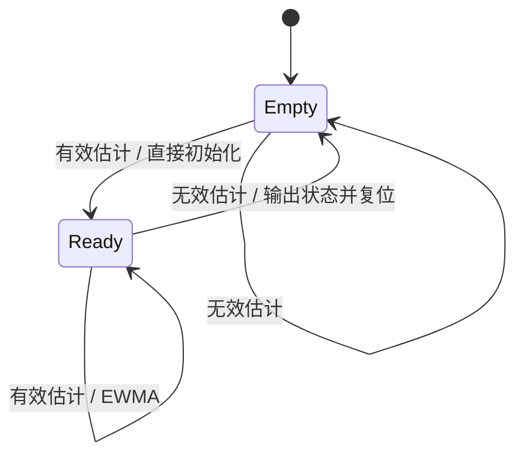

# 技术设计与模块边界

## 问题与目标

给定一帧带背景和噪声的衰减信号，估计能描述衰减速度的相对参数 τ，同时回答：结果是否有效、算法在什么条件下失效、不同方法的误差和代价如何比较。

目标是可运行、可复现、可讲解的软件项目。真实时间尺度、探头标定与硬件接口属于后续独立工作。

## 信号模型

```text
x[i] = i / 31, i = 0..31
y[i] = background + amplitude * exp(-x[i] / tau) + noise[i]
```

背景作为输入给定；每帧固定 32 点。采用固定帧长便于约束内存和验证索引，代价是暂不支持任意采样率、非等间隔采样或变长帧。CSV 可输入符合格式的数列，但格式符合不意味着真实探头数据已被验证。

## 模块划分

| 层 | 模块 | 职责与边界 |
|---|---|---|
| 公共数据 | `demo.h` | 帧、窗口、原始分析结果、滤波状态、反馈枚举 |
| 算法 API | `estimator.h` | 方法选择、参数边界、状态码和诊断结果 |
| 合成输入 | `simulation.c` / `noise.c` | 原始八帧演示 / 带显式 RNG 状态的可控高斯噪声 |
| 特征提取 | `analysis.c` / `estimator.c` | 原始双窗口 API / 三方法统一接口 |
| 状态处理 | `smoothing.c` | 有效输入的指数加权平滑，异常时保持内部状态 |
| 主机适配 | `frame_io.c` / `cli.c` | 文件解析、参数校验、报告状态、选择何时清空滤波历史 |
| 评测 | `report.py` / `plot.py` | 原始数据校验、指标汇总、可视化 |

算法核心不分配堆内存、不操作文件、不依赖操作系统。文件 I/O 与 CLI 单独编译；Python 不参与 C 运行时计算。`libfluorescence.a` 包含原始 demo 核心和新增估计器/仿真，不包含 CSV 或 CLI。

## 一帧的生命周期

1. CSV 检查列数、数值、行长度与递增帧号；语法错误立即终止。
2. 估计器检查窗口边界、τ 上下限和拟合区间的有限数。
3. 扣除背景，按最大绝对信号缩放，减少平方与求和溢出风险。
4. 调用选定方法估计 τ，再用信号域最小二乘求幅值与统一残差指标。
5. 成功时返回结果；失败时结果清零并返回状态码。调用方必须检查状态。
6. CLI 只平滑成功帧；失败帧的数值字段留空并清空历史，下一有效帧重新初始化。



这里的状态机是离线结果有效性管理，不是设备闭环控制。

## 为什么这样设计

- **保留简单基线**：双窗口便于解释，也能揭示复杂方法的收益与成本。
- **统一诊断区间**：方法都在 4..19 上计算残差；双窗口仅用其中 8 点估计 τ，读者能看到实际信息利用差异。
- **约束搜索**：避免输出无穷大或明显越界的参数；边界命中报告失败，不伪装成可信估计。
- **状态显式化**：拒绝帧不会输出旧值，避免调用方将“有数值”误认为“本帧有效”。
- **原始记录可审查**：报告保留失败率，配对比较使用同一成功子集，不隐去困难样本。

## 当前局限

背景已知、单指数与等间隔采样是假设。没有做背景联合拟合、IRF 卷积、多指数分解、鲁棒损失或温度标定。残差/R² 是诊断量，没有实现依据它们自动拒绝失配信号的策略。NLS 的 65 点网格与局部细化也不是任意输入上的全局最优证明。
